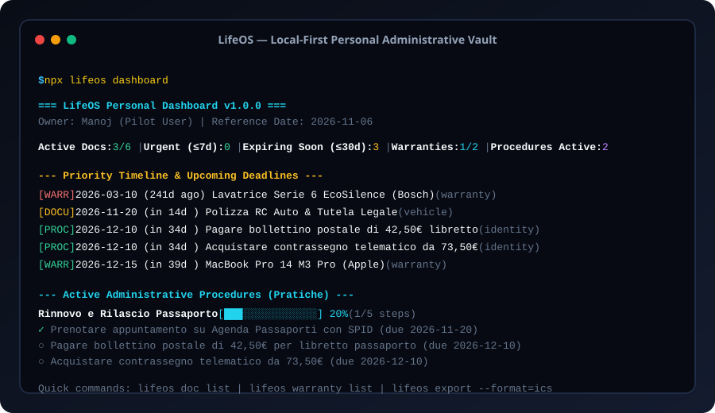

# LifeOS — Sistema Operativo Personale Local-First

[Italiano](README.it.md) · [English](README.md) · [Architettura](docs/ARCHITECTURE.md) · [Piano di Sviluppo](docs/ROADMAP.md) · [Checklist Lancio](docs/LAUNCH.md) · [Changelog](CHANGELOG.md)

[](LICENSE)
[](https://github.com/MRJonam91/LifeOS/actions/workflows/ci.yml)
[](package.json)
[](package.json)
[](https://github.com/sponsors/MRJonam91)



**LifeOS** è un cruscotto personale e sistema operativo local-first, indipendente e privo di cloud per la gestione della vita amministrativa. Centralizza documenti di identità, patenti, polizze, contratti di affitto, garanzie di legge sui prodotti e pratiche burocratiche a step in un archivio JSON locale atomico, con esportazione di feed calendario iCal (.ics) e report HTML offline.

---

## 🎯 Il Problema

La gestione delle pratiche amministrative e delle scadenze personali è caotica e dispersa:
- **Dispersione Documentale**: Passaporti, carte d'identità, patenti, contratti di locazione e polizze sono sparsi tra email, cassetti e app disconnesse.
- **Scadenze e Preavvisi Mancati**: Finestre di preavviso di disdetta (es. 6 mesi per l'affitto, 30/60 giorni per contratti) sfuggono, causando rinnovi taciti indesiderati o impossibilità di viaggiare.
- **Garanzie Legali Non Esercitate**: Gli scontrini e le ricevute sbiadiscono, costringendo i cittadini a pagare riparazioni di tasca propria su beni ancora coperti dalla garanzia legale biennale di 24 mesi.
- **Burocrazia Complessa**: Le pratiche della Pubblica Amministrazione (rinnovo passaporto in questura, cambio di residenza ANPR, bollettini postali) mancano di una checklist univoca passo-passo.
- **Rischio Privacy**: Servizi cloud commerciali monetizzano i dati anagrafici o li espongono a violazioni di sicurezza.

---

## 💡 La Soluzione: LifeOS

LifeOS restituisce sovranità, ordine e sicurezza alla gestione personale:

1. **Vault Personale Locale e Privato**: 100% offline, zero telemetria, zero tracking. Tutti i dati rimangono sul computer dell'utente in `~/.lifeos/vault.json`.
2. **Timeline Unificata delle Priorità**: Monitoraggio in tempo reale del livello di urgenza (`scaduto`, `urgente ≤7d`, `a breve ≤30d`, `in arrivo ≤90d`, `futuro`).
3. **Tutela della Garanzia Legale**: Calcolo automatico del termine di 24 mesi di legge per i consumatori, abbinando matricole, rivenditore e scontrino.
4. **Tracciamento Pratiche Amministrative (PA)**: Checklist operative a step con barre di avanzamento grafiche e scadenze intermedie (es. pagamento bollettino, contrassegno telematico, appuntamento questura).
5. **Feed iCalendar Standard (RFC 5545)**: Esportazione di feed `.ics` con promemoria anticipati a 7 giorni e al giorno della scadenza, integrabili in Apple Calendar, Google Calendar, Outlook e Thunderbird.
6. **Zero Dipendenze Runtime & Core < 1.500 Righe**: Scritto in moderno TypeScript puro con primitive native Node.js; codice compatto, verificabile e modificabile in meno di un'ora.

---

## 🚀 Avvio rapido​‌​​‌‌​‌​‌​‌​​‌​​‌​​‌​‌​​​‌‌‌​​‌​​‌‌​​​‌​​‌​‌‌​‌​‌‌​‌‌​​​‌‌​‌​​‌​‌‌​​‌‌​​‌‌​​‌​‌​‌‌​‌‌‌‌​‌‌‌​​‌‌​​‌​‌‌​‌​​‌‌​‌‌‌​‌‌​​​‌​​​‌‌​‌​​​​‌‌​​​‌​‌‌​​‌​‌​​‌‌‌​​‌

Avvia all'istante con `npx` o clona il repository:

```bash
# 1. Visualizza il cruscotto personale con lo scenario pilota sintetico
npx lifeos demo

# 2. Aggiungi un documento di identità
npx lifeos doc add --title="Passaporto Italiano" --category=identity --expiry=2034-05-10 --issuer="Questura di Torino"

# 3. Registra una garanzia (calcola automaticamente la scadenza a 24 mesi)
npx lifeos warranty add --item="MacBook Pro 14 M3" --purchase=2025-01-15 --months=24 --brand="Apple"

# 4. Controlla le pratiche in corso e spunta un passaggio completato
npx lifeos task list
npx lifeos task done --id=proc_passaporto_rinnovo --step=step_bollettino

# 5. Esporta il feed iCalendar per sincronizzare lo smartphone o il calendario
npx lifeos export --format=ics --out=scadenze-personali.ics

# 6. Genera il report HTML interattivo offline
npx lifeos export --format=html --out=cruscotto.html
```

### Installazione

```bash
npm install -g lifeos
# oppure installa da sorgente:
git clone https://github.com/MRJonam91/LifeOS.git
cd LifeOS
npm install
npm test
npm run build
```

---

## 📐 Architettura e Confini del Progetto

- **Fatti Osservati Verificabili**: Numeri di protocollo, estremi di emissione e scadenza, importi e codici di scontrini/fatture.
- **Stime Calcolate**: Giorni di validità residua, finestre di disdetta e calcolo garanzia legale standard.
- **Decisioni Umane**: Scelta di recedere da un contratto, prenotazione visite mediche o appuntamenti fisici.

LifeOS non duplica password manager o banche: è il raccoglitore amministrativo essenziale per non perdere diritti e scadenze.

Dettagli architetturali completi: [docs/ARCHITECTURE.md](docs/ARCHITECTURE.md).

---

## 📄 Licenza e Uso Commerciale

LifeOS adotta un modello a doppia licenza:
- **Open-Source (AGPL-3.0-only)**: Libero per uso personale, modifica e auto-hosting. Eventuali servizi web o SaaS derivati devono condividere il codice sorgente modificato.
- **Licenza Commerciale**: Per aziende di welfare aziendale, portali bancari/assicurativi o piattaforme commerciali che desiderano integrare LifeOS senza vincoli AGPL.

Vedi [LICENSING.md](LICENSING.md) e [COMMERCIAL-LICENSE.md](COMMERCIAL-LICENSE.md).

---

## 💖 Sostieni il progetto / Sponsor this project

LifeOS è un software libero e indipendente sviluppato da **Manoj Rollo (MRJonam91)**. Non dipende da investitori, capitali di rischio o pubblicità. Se questo strumento ti aiuta a non perdere una scadenza o protegge i tuoi diritti e garanzie, considera una donazione per sostenerne la manutenzione continua:

- [💖 Sponsorizza su GitHub Sponsors](https://github.com/sponsors/MRJonam91)
- [☕ Offrimi un caffè su Ko-fi](https://ko-fi.com/mrjonam)
- [⚡ Buy Me A Coffee](https://buymeacoffee.com/mrjonam)
- [💳 PayPal rapido](https://paypal.me/manorollo)
