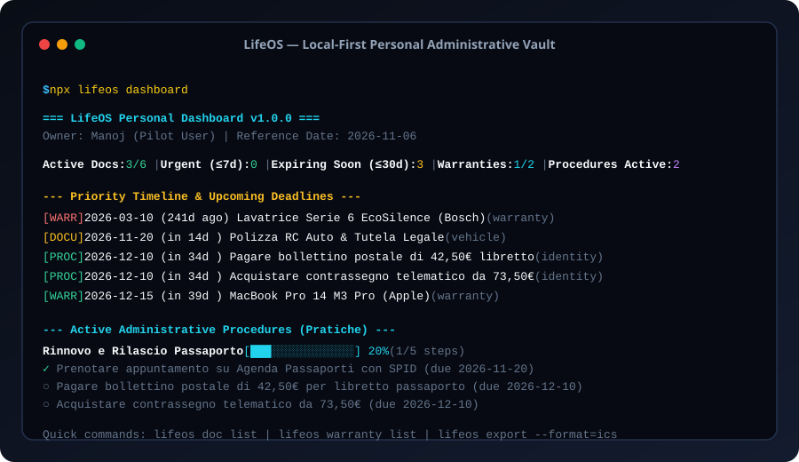

# LifeOS — Local-First Personal Operating System

[Italiano](README.it.md) · [English](README.md) · [Architecture](docs/ARCHITECTURE.md) · [Roadmap](docs/ROADMAP.md) · [Launch Checklist](docs/LAUNCH.md) · [Changelog](CHANGELOG.md)

[](LICENSE)
[](https://github.com/MRJonam91/LifeOS/actions/workflows/ci.yml)
[](package.json)
[](package.json)
[](https://github.com/sponsors/MRJonam91)



**LifeOS** is a local-first, zero-cloud personal operating system for your administrative life. It consolidates personal identity documents, vehicle papers, insurance policies, statutory warranties, and bureaucratic multi-step procedures into a deterministic, private JSON vault with iCalendar feed exports and offline HTML reports.

---

## 🎯 The Problem

Personal administration and civil deadlines are dangerously fragmented:
- **Scattered Across Multiple Channels**: Passports, driver's licenses, lease renewal terms, and insurance policies are buried across email folders, paper binders, and disjointed apps.
- **Missed Cancellation & Renewal Deadlines**: Unnoticed 60-day or 6-month notice windows lead to unintended contract renewals or invalid travel documents when booking trips.
- **Unclaimed Warranties**: Consumer goods receipts fade away, causing owners to pay out of pocket for repairs legally covered under the 24-month statutory warranty.
- **Chaotic Bureaucracy**: Multi-step administrative tasks (passport application, residency change, tax declarations) lack unified step-by-step checklists and tracking.
- **Privacy Invasion**: Cloud-based personal document apps monetize user metadata or present single-point-of-failure security risks.

---

## 💡 The Solution: LifeOS

LifeOS brings clarity, discipline, and total privacy to personal life administration:

1. **Local-First Personal Vault**: 100% offline, zero tracking, zero telemetries. Sensitive personal data stays strictly on your machine in `~/.lifeos/vault.json`.
2. **Unified Priority Timeline**: Real-time urgency calculation (`overdue`, `urgent ≤7d`, `soon ≤30d`, `upcoming ≤90d`, `future`).
3. **Statutory Warranty Guardian**: Automatically calculates the statutory 24-month consumer warranty duration and associates proof-of-purchase references and serial numbers.
4. **Administrative Procedure Checklist**: Step-by-step progress bars and due dates for complex bureaucratic paperwork (e.g. passport issuance, residency transfer).
5. **Standard RFC 5545 iCalendar Feeds**: Exports clean `.ics` calendar files with multi-stage reminder alarms (`-P7D`, `-P0D`) compatible with Apple Calendar, Google Calendar, and Outlook.
6. **Zero Runtime Dependencies & < 1,500 LOC Core**: Written in modern pure TypeScript, running natively on Node.js without third-party runtime package overhead.

---

## 🚀 Quick start​‌​​‌‌​‌​‌​‌​​‌​​‌​​‌​‌​​​‌‌‌​​‌​​‌‌​​​‌​​‌​‌‌​‌​‌‌​‌‌​​​‌‌​‌​​‌​‌‌​​‌‌​​‌‌​​‌​‌​‌‌​‌‌‌‌​‌‌‌​​‌‌​​‌​‌‌​‌​​‌‌​‌‌‌​‌‌​​​‌​​​‌‌​‌​​​​‌‌​​​‌​‌‌​​‌​‌​​‌‌‌​​‌

Launch instantly with `npx` or clone the repository:

```bash
# 1. View the personal dashboard with the pre-loaded synthetic pilot scenario
npx lifeos demo

# 2. Run the Tripartite Integrity Audit (Observed Facts vs Estimates vs Decisions)
npx lifeos audit

# 3. Fast search across documents, warranties, and paperwork
npx lifeos search passaporto

# 4. Add an identity document
npx lifeos doc add --title="Passaporto Italiano" --category=identity --expiry=2034-05-10 --issuer="Questura di Torino"

# 5. Add an appliance or hardware warranty (calculates 24-month statutory warranty automatically)
npx lifeos warranty add --item="MacBook Pro 14 M3" --purchase=2025-01-15 --months=24 --brand="Apple"

# 6. View active paperwork and tick off a completed step
npx lifeos task list
npx lifeos task done --id=proc_passaporto_rinnovo --step=step_bollettino

# 7. Export an iCalendar feed to sync with your phone / calendar
npx lifeos export --format=ics --out=lifeos-deadlines.ics

# 8. Export a printable Markdown dossier or interactive offline HTML report
npx lifeos export --format=md --out=Dossier.md
npx lifeos export --format=html --out=dashboard.html
```

### Installation

```bash
npm install -g lifeos
# or clone locally:
git clone https://github.com/MRJonam91/LifeOS.git
cd LifeOS
npm install
npm test
npm run build
```

---

## 📐 Architecture & Core Boundaries

- **Observed Verifiable Facts**: Exact document IDs, issue/expiry dates, verified receipt numbers, and executed checklist timestamps.
- **Calculated Estimates**: Countdown days, urgency classifications, and standard warranty durations.
- **Required Human Decisions**: Passport appointments, notice of contract termination, and fee payments.

LifeOS does not replace your bank or password manager: it is the master administrative binder that ensures you never miss a deadline or lose a warranty.

Detailed architectural specifications: [docs/ARCHITECTURE.md](docs/ARCHITECTURE.md).

---

## 📄 Licensing & Commercial Use

LifeOS is dual-licensed:
- **Open-Source (AGPL-3.0-only)**: Free to use, inspect, modify, and self-host under copyleft terms. Derivative SaaS or network services must disclose their modified source code.
- **Commercial License**: For enterprise employee benefits portals, insurance companies, or commercial software wishing to embed LifeOS without AGPL-3.0 copyleft terms.

See [LICENSING.md](LICENSING.md) and [COMMERCIAL-LICENSE.md](COMMERCIAL-LICENSE.md) for complete details.

---

## 💖 Sponsor this project

LifeOS is free and open-source software built and maintained by **Manoj Rollo (MRJonam91)**. If LifeOS helps protect your personal rights, saves you money on warranties, or prevents missed administrative deadlines, please consider sponsoring:

- [💖 Sponsor on GitHub Sponsors](https://github.com/sponsors/MRJonam91)
- [☕ Buy me a coffee on Ko-fi](https://ko-fi.com/mrjonam)
- [⚡ Buy Me A Coffee](https://buymeacoffee.com/mrjonam)
- [💳 Direct PayPal donation](https://paypal.me/manorollo)
